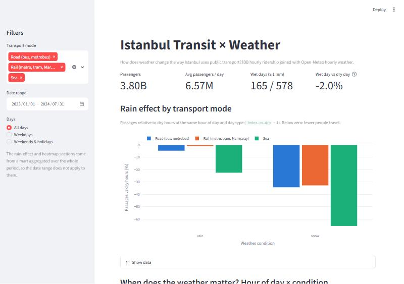
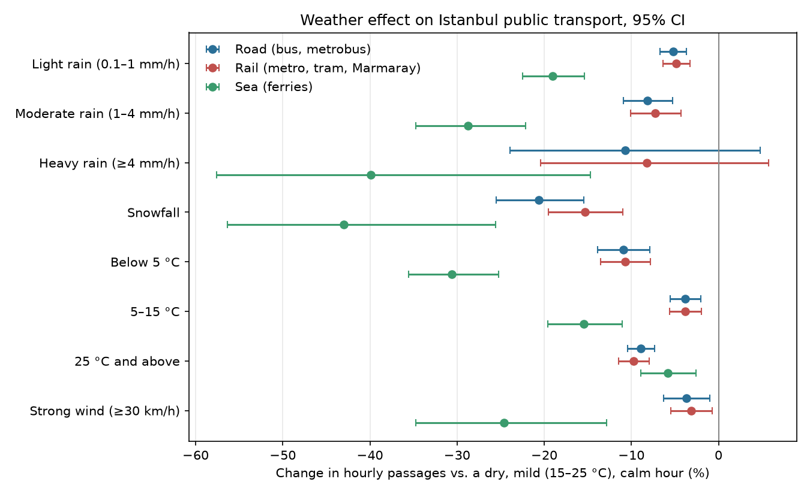
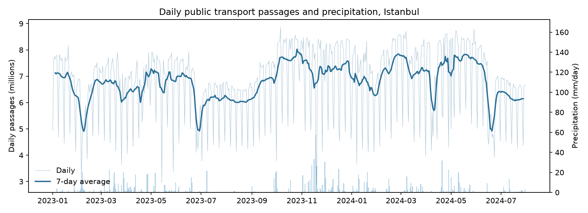

# Istanbul Transit × Weather

**How does weather change the way Istanbul uses public transport?**

An end-to-end, laptop-scale data pipeline that joins **310 million rows** of Istanbul Metropolitan
Municipality (İBB) hourly ridership with hourly historical weather, models it with dbt,
orchestrates it with Dagster, estimates weather effects with a fixed-effects regression and serves
the results in a Streamlit dashboard.



## Findings

January 2023 – July 2024 (578 days, 3.8 billion passengers), service hours 06:00–24:00. Each
estimate is the change in hourly passages compared with a dry, 15–25 °C, calm hour, **controlling
for hour of the week, public holidays and the calendar month**, so rush hours, weekends and seasons
(school terms, summer) do not masquerade as weather. 95% confidence intervals use standard errors clustered by
day. Full table: [docs/analysis/results.md](docs/analysis/results.md).

| Weather | Road (bus, metrobus) | Rail (metro, tram, Marmaray) | Sea (ferries) |
|---|---:|---:|---:|
| Light rain (0.1–1 mm/h) | −5.2% | −4.9% | −19.0% |
| Moderate rain (1–4 mm/h) | −8.1% | −7.2% | −28.7% |
| Heavy rain (≥ 4 mm/h, 23 hours) | −10.7%\* | −8.2%\* | −39.9% |
| Snowfall | −20.6% | −15.3% | −43.0% |
| Below 5 °C | −10.9% | −10.7% | −30.6% |
| 25 °C and above | −8.9% | −9.7% | −5.8% |
| Strong wind (≥ 30 km/h) | −3.7% | −3.1% | −24.6% |

\* confidence interval includes zero.

1. **Rain does not push people onto public transport; it keeps them at home.** Every rain
   intensity lowers ridership on every mode, and the drop grows with intensity: about 5% for light
   rain and 7–8% for moderate rain on road and rail.
2. **Ferries are the most weather-sensitive mode by far.** Light rain costs ferries 19% of their
   passengers, strong wind 25% and snow 43%, several times the effect on land. Part of this is
   supply, not demand: some ferry services stop in bad weather.
3. **Snow is the biggest disruptor on land.** Buses lose 21% and rail 15%, the largest effects in
   the model. Rail holds up better than road in snow, consistent with rail running on its own right
   of way while buses get stuck in traffic.
4. **People travel most in mild weather.** Both cold (below 5 °C) and heat (25 °C and above) cost
   land modes about 9–11%, even after controlling for the month.



The daily series also shows how much non-weather events matter: the deep dips line up with the
Eid holidays (Kurban Bayramı June 2023 and June 2024, Ramazan Bayramı April 2024) and the weeks
after the 6 February 2023 earthquakes.



**Limitations.** This is observational data, so these are associations: the model controls for time
of week, holidays and month, but not for everything that co-occurs with weather. One weather grid
point represents a city that spans ~100 km and two continents. Ridership is card taps
(`number_of_passage`), so trips without an İstanbulkart are invisible, as is any shift to cars and
taxis. Heavy-rain hours are rare (23 in the period), hence the wide intervals.

## Architecture

```
İBB Open Data (CKAN API, ~1 GB CSV / month) ─┐
                                              ├─► raw Parquet ─► dbt (DuckDB) ─► marts ─┬─► Streamlit dashboard
Open-Meteo Archive API (hourly JSON) ─────────┘   data/raw       staging → intermediate  └─► analysis (OLS, FE)
                    ▲                                            → marts, 58 tests
                    └──────── Dagster: monthly partitions, asset checks, schedule ────────┘
```

| Layer | Tool | Notes |
|---|---|---|
| Ingestion | Python, httpx, DuckDB | Each ~1 GB monthly CSV is streamed to disk and converted to zstd Parquet with DuckDB (≈35 s per month, ~16M rows → ~85 MB); retries with backoff; idempotent month partitions |
| Storage | DuckDB, Parquet | Raw Parquet partitioned by `year=/month=`, single-file warehouse |
| Transformation | dbt-duckdb | Staging, intermediate and mart models, Turkish public-holiday seed, model contracts, 58 data tests |
| Orchestration | Dagster | Monthly partitions, asset checks (row counts, complete weather hours), monthly schedule, dbt assets via `dagster-dbt` |
| Analysis | NumPy, pandas, matplotlib | Log-linear OLS with day-of-week × hour, holiday × hour and month fixed effects; clustered standard errors |
| Serving | Streamlit, Plotly | KPIs, rain effect by mode, hour × condition heatmap, temperature curve, daily series |
| CI | GitHub Actions | Ruff, pytest (47 tests, no network), `dbt build` on generated fixture data |

## Data quality

Real open data is messy; these were found and handled along the way (details in
[docs/DATA_NOTES.md](docs/DATA_NOTES.md)):

- **November and December 2024 are published empty** (header only). Ingestion skips them with a
  warning and Dagster reports a warning-level check instead of failing.
- **August–October 2024 are incomplete**: 1.1–2.2 million passages per day instead of 6–7.7
  million, and October has only 18 days. The default range stops at July 2024.
- **The December 2024 resource links to a file named `…202512.csv`** (December 2025). Months are
  taken from the Turkish resource name (`Aralık 2024`) and mismatches are logged.
- The portal's data dictionary describes differing column names between months, but all 60 CSV
  headers turned out to be identical. Ingestion still normalises names and tolerates missing columns.

## Quickstart

Requires Python 3.11+ and ~2 GB of free disk for 19 months of data (the CSVs are streamed and
deleted after conversion).

```bash
python -m venv .venv
source .venv/bin/activate              # Windows: .venv\Scripts\activate
pip install -e ".[dev,analysis]"
```

**With Dagster** (recommended): `dagster dev`, open http://localhost:3000, backfill the `raw`
assets for all monthly partitions, then materialise the dbt assets.

**Or step by step:**

```bash
python -m transit_weather.ingestion.weather        # 2023-01 … 2024-07 by default
python -m transit_weather.ingestion.ibb            # ~19 GB download, ~12 minutes
export TW_DATA_DIR="$PWD/data"                     # PowerShell: $env:TW_DATA_DIR = "$PWD\data"
dbt build --project-dir dbt --profiles-dir dbt
python analysis/weather_effect.py                  # writes docs/analysis and docs/img
streamlit run dashboard/app.py
```

Change the period with `TW_START_MONTH` / `TW_END_MONTH` (format `YYYY-MM`).

Tests: `pytest` (unit tests, no network) and `ruff check .`.

## Project layout

```
src/transit_weather/   config, ingestion (ibb.py, weather.py), Dagster definitions
dbt/                   dbt project: staging, intermediate, marts, seed, tests, fixture generator
analysis/              weather-effect regression and charts
dashboard/             Streamlit app and its SQL
tests/                 pytest suite
docs/                  data notes, analysis results, images
```

## Data sources

- [İBB Hourly Public Transport Data Set](https://data.ibb.gov.tr/en/dataset/hourly-public-transport-data-set)
  (İBB Open Data Portal)
- [Open-Meteo Historical Weather API](https://open-meteo.com/en/docs/historical-weather-api)
